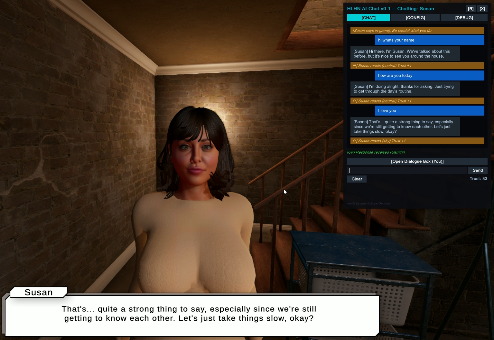

# HLHN AI Chat Mod

A BepInEx mod for **He Lives Here Now** by EvilGuest, that integrates AI-powered dialogue and interactive chat into the game. Chat seamlessly with the four main characters (Katherine, Susan, Stacy and Laura) as well with random NPCs. AI responses play through the game's dialogue boxes, complete with dynamic facial expressions, emotional reactions, and in-game physical actions.

---



## Features

- 🤖 **Multiple AI Backends** — Supports local models via **LM Studio** / **Ollama** (recommended: `defyma85/gemma-4-E4B-it-ultra-uncensored-heretic-Q4_K_M_gguf`) and cloud model **Google Gemini API**.
- 💬 **Radial Menu & Native Dialogue Box** — Approach any NPC, press **E** to open the radial interaction menu, and select **AI**. Chat using text input with real-time typing.
- 🎭 **Dynamic Facial Reactions & Animations** — NPCs react visually to conversation sentiment: positive compliments trigger happy expressions and good dialogue animations; insults or negative replies trigger angry or annoyed reactions.
- 📖 **In-Game Tutorial System** — Full 5-page illustrated tutorial accessible directly from the pause menu (**ESC → Tutorial → AI chat mod**). Tutorial images are loaded dynamically from `BepInEx/config/AIChat/`.
- 🧠 **Deep Character Context** — The AI is aware of each NPC's personality, trust level, submission/desire stats, clothing status, and nearby environment.
- 🎮 **Autonomous Action Commands** — The AI can execute game actions embedded in its responses:
  - Follow / Stop following
  - Go to a room or perform routine chores (kitchen, sofa, bed, laundry, sweeping, watering plants...)
  - Put on / Remove any clothing item
  - Kiss, facial expressions, and emotion adjustments
- 🌐 **Multilingual Support** — Player messages are understood in English, Spanish, and any language supported by the AI model.
- 💾 **Persistent Memory & Milestones** — Conversation histories, relationship milestones (intimacy, virginity, orgasms), and character summaries are automatically saved to disk.

---

## Requirements

| Requirement | Version |
|---|---|
| BepInEx | 5.x |
| .NET Standard | 2.1 |
| Game | HLHN v6.4+ |

---

## Installation

### First Steps - Download the mod

1. Download the latest `HLHN_AIChatMod.zip` from the [releases page](https://github.com/agentesupersecreto/HLHN-AIChatMod/releases)
2. Unzip and copy all the files from `HLHN_AIChatMod` folder into `He Lives Here Now` game folder (If it asks you to replace, replace).

### Second Step - Configure

**For Google Gemini (Not recommended, as interactions with the AI ​​are NSFW and violate the API's terms of use)**:
Use at your own risk; create a new Google account or use one you don't normally use to generate the API key.
Go to https://aistudio.google.com/api-keys and create an API key (you must create or select any project), copy the key, and paste it into the “Gemini API Key” field in the AI Chat window (CTRL + V).

**For Local AI (Ollama / Gemma) Recommended**:
1. Download Ollama from https://ollama.com/download and install.
2. Open a powershell terminal, copy and paste this command `ollama run defyma85/gemma-4-E4B-it-ultra-uncensored-heretic-Q4_K_M_gguf` and press Enter.
3. Wait for the download and extraction to complete. Upon success, it will ask you to send a message; simply type /bye or close the terminal.
*Make sure Ollama is running on your PC and that you have downloaded a model; for the Ollama model name, you must enter the exact name of the model.*
5. Open the game and load a save or start new game, press f9 and switch to the Ollama provider in the config panel and enter the model name (in this case `defyma85/gemma-4-E4B-it-ultra-uncensored-heretic-Q4_K_M_gguf`), It will be set by default.

**IMPORTANT**: Local AI models are resource-intensive. Ensure you have a mid-to-high-end PC with a graphics card with at least 8 GB of VRAM; 12 GB or more is recommended. Avoid using extremely lightweight or older AI models, as responses will degrade. The recommended AI model for this mod is lightweight; it isn't very smart, but it works well for roleplay. If you have a graphics card with 12 or 16 GB of VRAM, it's better to use a Gemma-4 model, but the “abliterated” version.

### Third Step - Use

4. Open the game, approach a girl, press E and select the “AI” option.
You can watch a brief tutorial on how to use the mod in the pause menu (Press ESC) > Tutorial > AI Chat Mod.

---

## Configuration

On first run, the mod automatically creates its configuration directory:

```
<game_folder>/BepInEx/config/AIChat/
├── HLHN_AIChatMod.ini   <- settings (editable in-game via F9 Settings panel)
├── system_prompt.txt    <- editable system prompt template
├── custom_prompt.txt    <- extra custom rules injected into every prompt
├── 1.jpg ... 5.jpg      <- tutorial screenshots
├── memory/              <- persistent character memory & intimacy milestones
│   └── Katherine.txt
└── history/             <- persistent chat logs
    └── Katherine_history.txt
```

### In-Game Settings Panel

Press **F9** and click `[CONFIG]` to configure settings:

| Setting | Default | Description |
|---|---|---|
| Provider | `Ollama` | AI backend: `Ollama` (local), `Gemini` (API), or `Gemma` (LM Studio / Ollama) |
| OllamaUrl | `http://localhost:11434/api/chat` | Ollama chat endpoint |
| OllamaModel | `defyma85/gemma-4-E4B-it-ultra-uncensored-heretic-Q4_K_M_gguf` | Ollama model identifier |
| GemmaUrl | `http://localhost:1234/api/generate` | Local endpoint for LM Studio or Ollama generate API |
| GemmaModel | `defyma85/gemma-4-E4B-it-ultra-uncensored-heretic-Q4_K_M_gguf` | Recommended uncensored local model |
| ApiKey | *(empty)* | Google Gemini API key |
| MaxHistory | `30` | Number of messages maintained in context |
| AllowTrustMod | `true` | Allows AI sentiment to influence NPC trust |
| NativeDialogueInput | `true` | Enables dialogue box input |
| NativeSpeakerName | `You` | Player display name in dialogue boxes |
| AI Commands | all `ON` | Toggles for individual commands (`follow`, `goto`, `clothes`, `kiss`, etc.) |

---

## How to Play

### 1. Native In-Game Interaction (Immersive)
1. Walk up to any character or NPC.
2. Press **E** to open the interaction menu.
3. Select the **AI** option.
4. The dialogue box opens.
5. Type your message and press **Enter** to send.
6. The NPC answers, plays facial reactions and may perform actions.
7. Press **Space** or **Enter** to advance dialogue, or press **Space** while your input box is empty to close it and resume free movement.

### 2. Full Chat & Debug Window (F9)
* Press **F9** at any time to open the complete IMGUI window.
* Switch between **Chat**, **Memory**, **Settings**, and **Debug** tabs.
* Inspect character trust, submission, desires, and current routine tasks.

### 3. In-Game Tutorial
* Press **ESC** to open the pause menu.
* Click **Tutorial** and choose **AI chat mod**.
* Browse the 5 illustrated pages for in-depth guidance on setup, commands, and conversation tips.

---

## AI Action Commands

The AI can embed action commands into its replies to trigger in-game behaviors seamlessly. These tags are executed by the mod and stripped from the displayed speech.

| Command | Example | Description | Requirement |
|---|---|---|---|
| `follow` | `[CMD:follow]` | NPC starts following the player | `Trust >= ValueToFollow` |
| `follow:stop` | `[CMD:follow:stop]` | NPC stops following | — |
| `goto:<place>` | `[CMD:goto:Do laundry]` | NPC walks to a room or chore spot in the house | `Trust >= ValueToFollow` |
| `places` | `[CMD:places]` | Displays available locations in the scene | — |
| `remove_cloth:<slot>` | `[CMD:remove_cloth:dress]` | Removes a specific clothing item | `Trust >= ValueToUndress` |
| `put_cloth:<slot>` | `[CMD:put_cloth:bra]` | Puts on a specific clothing item | — |
| `kiss` | `[CMD:kiss]` | NPC kisses the player | `Trust >= ValueToKiss` |
| `make_face:<type>` | `[CMD:make_face:happy]` | Changes facial expression (`happy`, `aroused`, `angry`, `annoyed`, `sad`, `neutral`) | — |
| `modify_trust:<value>` | `[CMD:modify_trust:5]` | Adjusts trust level up or down | — |
| `modify_emotion:<stat>:<val>` | `[CMD:modify_emotion:submission:10]` | Modifies emotional stats (`submission`, `perversion`, `desire`, `hornylevel`) | — |
| `say:<text>` | `[CMD:say:Come with me]` | Forces the NPC to speak text in-game | — |

---

## Troubleshooting

| Issue | Resolution |
|---|---|
| The chat window doesn't open with F9 | Ensure BepInEx 5 is installed and `HLHN_AIChatMod.dll` is inside `BepInEx/plugins/`. Check `BepInEx/LogOutput.log`. |
| Interaction menu doesn't show "AI" option | Stand in front of the NPC, then press **E**. If you press E when the girl has her back to you or is turned to the side, the AI option won't appear. |
| AI returns empty or slow replies | For local AI, ensure LM Studio or Ollama is running and the model is loaded. Depending on your computer, the screen may freeze and responses may be slow.
For Gemini, verify your API key in Settings (**F9 → CONFIG**), on some occasions, the Gemini service may be busy. |
| Tutorial images are missing or white | Verify that `1.jpg` through `5.jpg` (or `.png`) are placed in `BepInEx/config/AIChat/`. |
| UI mod turn transparent after scene change | IMGUI textures auto-reload on scene load; if needed, click **Force Reinit Styles** under the Debug tab. |

If you're using Ollama, every time you're going to use the mod, make sure Ollama is running in the background (it's usually in the hidden icons).

---
